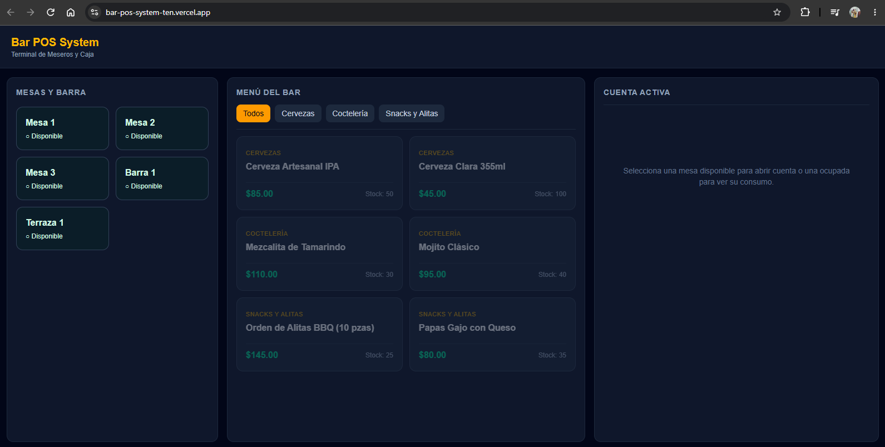

#  Bar POS System — Full Stack Point of Sale

Sistema de Punto de Venta (POS) y gestión de mesas diseñado para bares y restaurantes. Permite administrar la apertura de cuentas por mesa o barra, agregar rondas de consumo con control transaccional de inventario en tiempo real y realizar el cierre y cobro de caja.

 **Demo en vivo:** https://bar-pos-system-ten.vercel.app/  
 **API REST Base:** https://bar-pos-backend-f9yc.onrender.com/api

> [!NOTE]
> Antes de iniciar la demo en vivo ingresar a API REST Base


---

##  Vista Previa




---

##  Stack Tecnológico

* **Backend:** Java 21, Spring Boot 3, Spring Data JPA, Spring Security, Bean Validation, Maven.
* **Base de Datos:** PostgreSQL 16 (Docker en desarrollo / Neon en producción).
* **Frontend:** Next.js (App Router), React, TypeScript, Tailwind CSS.
* **Infraestructura & Herramientas:** Docker, Docker Compose, Git/GitHub.

---

##  Arquitectura y Decisiones Técnicas

* **Integridad Transaccional (`@Transactional`):** La apertura de mesas, el descuento de stock al agregar productos y el cierre de órdenes se ejecutan de forma atómica para evitar inconsistencias entre el estado de la mesa y el inventario.
* **Precisión Financiera:** Uso estricto de `BigDecimal` en el backend y almacenamiento histórico del precio unitario (`unit_price`) en cada ítem de la orden para proteger cuentas abiertas ante modificaciones futuras en el catálogo.
* **Arquitectura en Capas y DTOs:** Separación clara entre controladores REST (`controller`), lógica de negocio (`service`), acceso a datos (`repository`) y Java `records` (`dto`) para desacoplar la API de las entidades JPA.
* **Datos Iniciales Automatizados (`DataSeeder`):** Carga controlada de roles, catálogo base y distribución de mesas al iniciar en entornos limpios para facilitar pruebas inmediatas.

---

##  Estructura del Proyecto

 ```
bar-pos-system/
├── backend/               # API REST en Java + Spring Boot + Dockerfile
├── frontend/              # Interfaz operativa en Next.js + TypeScript
├── docker-compose.yml     # Contenedor PostgreSQL para desarrollo local
└── README.md
 ```
---

## Endpoints Principales de la API

| Método | Endpoint | Descripción |
| :--- | :--- | :--- |
| `GET` | `/api/tables` | Lista todas las mesas y su estado (`AVAILABLE` / `OCCUPIED`). |
| `GET` | `/api/catalog/categories` | Obtiene las categorías activas del menú. |
| `GET` | `/api/catalog/products` | Obtiene los productos activos (filtrable por `categoryId`). |
| `POST` | `/api/orders/open` | Abre una nueva cuenta en una mesa disponible. |
| `GET` | `/api/orders/table/{tableId}` | Consulta la orden abierta actual de una mesa. |
| `POST` | `/api/orders/{orderId}/items` | Agrega productos a la orden y descuenta el inventario. |
| `POST` | `/api/orders/{orderId}/pay` | Marca la orden como pagada (`PAID`) y libera la mesa. |

---

## Ejecución Local

### Requisitos previos
- Java 21 
- Node.js 18 o superior
- Docker y Docker Compose

### Pasos

1. **Clonar el repositorio:**
   ```
   git clone https://github.com/josuetorresdev/bar-pos-system.git
   cd bar-pos-system
   ```

2. **Levantar la base de datos PostgreSQL con Docker:**
   ```
   docker compose up -d
   ```

3. **Iniciar el Backend (Spring Boot):**
   ```
   cd backend
   ./mvnw spring-boot:run
   ```

4. **Iniciar el Frontend (Next.js):**
   ```
    cd frontend
    npm install
    npm run dev
   ```

4. **Abrir http://localhost:3000 en el navegador**

### Roadmap (Próximas Mejoras)
- [ ] Autenticación con JWT y control de acceso por roles (ADMIN, WAITER, CASHIER).
- [ ] Panel administrativo para CRUD de productos, categorías y reabastecimiento de inventario.
- [ ] Soporte para notas personalizadas por ítem en comanda y división de cuentas.
- [ ] Reporte de corte de caja diario y métricas de productos más vendidos.
