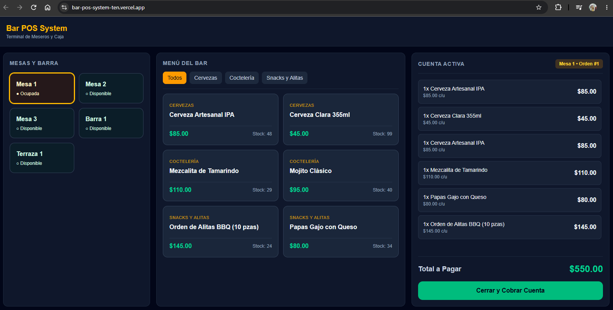

#  Bar POS System — Full Stack Point of Sale

Point of Sale (POS) and table management system designed for bars and restaurants. It allows managing open tabs by table or bar counter, adding consumption rounds with real-time transactional inventory control, and handling cash register closing and payment.

 **Live Demo:** https://bar-pos-system-ten.vercel.app/  
 **API REST Base:** https://bar-pos-backend-f9yc.onrender.com/api

> [!NOTE]
> Before starting the live demo, please visit the REST API Base URL to wake up the server.


---

##  Preview



---

##  Tech Stack

* **Backend:** Java 21, Spring Boot 3, Spring Data JPA, Spring Security, Bean Validation, Maven.
* **Database:** PostgreSQL 16 (Docker en desarrollo / Supabase in production).
* **Frontend:** Next.js (App Router), React, TypeScript, Tailwind CSS.
* **Infrastructure & Tools:** Docker, Docker Compose, Git/GitHub.

---

##  Architecture & Technical Decisions

* **Transactional Integrity (`@Transactional`):** Opening tables, deducting stock when adding products, and closing orders are executed atomically to prevent inconsistencies between table status and inventory.
* **Financial Precision:** Strict use of `BigDecimal` in the backend and historical storage of the unit price (`unit_price`) in each order item to protect open tabs from future catalog price changes.
* **Layered Architecture & DTOs:** Clear separation between REST controllers (`controller`), business logic (`service`), data access (`repository`), and Java `records` (`dto`) to decouple the API from JPA entities.
* **Automated Initial Data (`DataSeeder`):** Controlled loading of roles, base catalog, and table layout upon startup in clean environments to facilitate immediate testing.

---

##  Project Structure

 ```
bar-pos-system/
├── backend/               # Java + Spring Boot REST API + Dockerfile
├── frontend/              # Next.js + TypeScript operational interface
├── docker-compose.yml     # PostgreSQL container for local development
└── README.md
 ```
---

## Main API Endpoints

| Method | Endpoint | Description |
| :--- | :--- | :--- |
| `GET` | `/api/tables` | Lists all tables and their status (`AVAILABLE` / `OCCUPIED`). |
| `GET` | `/api/catalog/categories` | Retrieves active menu categories. |
| `GET` | `/api/catalog/products` | Retrieves active products (filterable by `categoryId`). |
| `POST` | `/api/orders/open` | Opens a new tab on an available table. |
| `GET` | `/api/orders/table/{tableId}` | Retrieves the current open order for a table. |
| `POST` | `/api/orders/{orderId}/items` | Adds products to the order and deducts inventory. |
| `POST` | `/api/orders/{orderId}/pay` | Marks the order as paid (`PAID`) and frees up the table. |

---

## Ejecución Local

### Requisitos previos
- Java 21 
- Node.js 18 o superior
- Docker and Docker Compose

### Steps

1. **Clone the repository:**
   ```
   git clone https://github.com/josuetorresdev/bar-pos-system.git
   cd bar-pos-system
   ```

2. **Start the PostgreSQL database with Docker:**
   ```
   docker compose up -d
   ```

3. **Start the Backend (Spring Boot):**
   ```
   cd backend
   ./mvnw spring-boot:run
   ```

4. **Start the Frontend (Next.js):**
   ```
    cd frontend
    npm install
    npm run dev
   ```

4. **Open http://localhost:3000 in your browser**

### Roadmap (Upcoming Improvements)
- [ ] JWT authentication and role-based access control (ADMIN, WAITER, CASHIER).
- [ ] Admin dashboard for product and category CRUD operations and inventory restocking.
- [ ] Support for custom notes per item on kitchen/bar tickets and bill splitting.
- [ ] Daily cash register closing report and best-selling product metrics.
